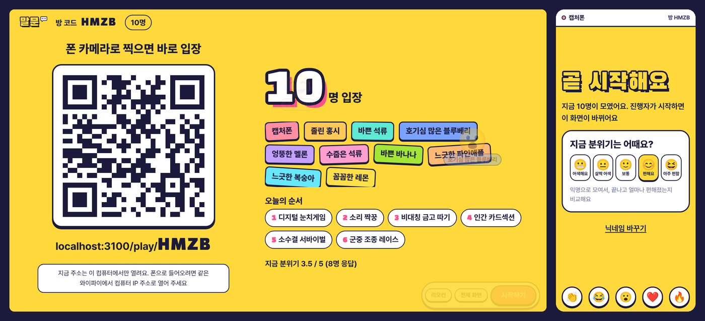
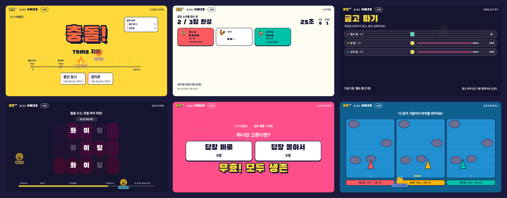
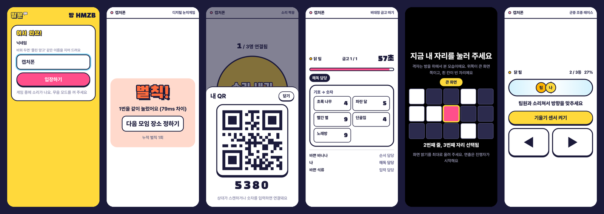
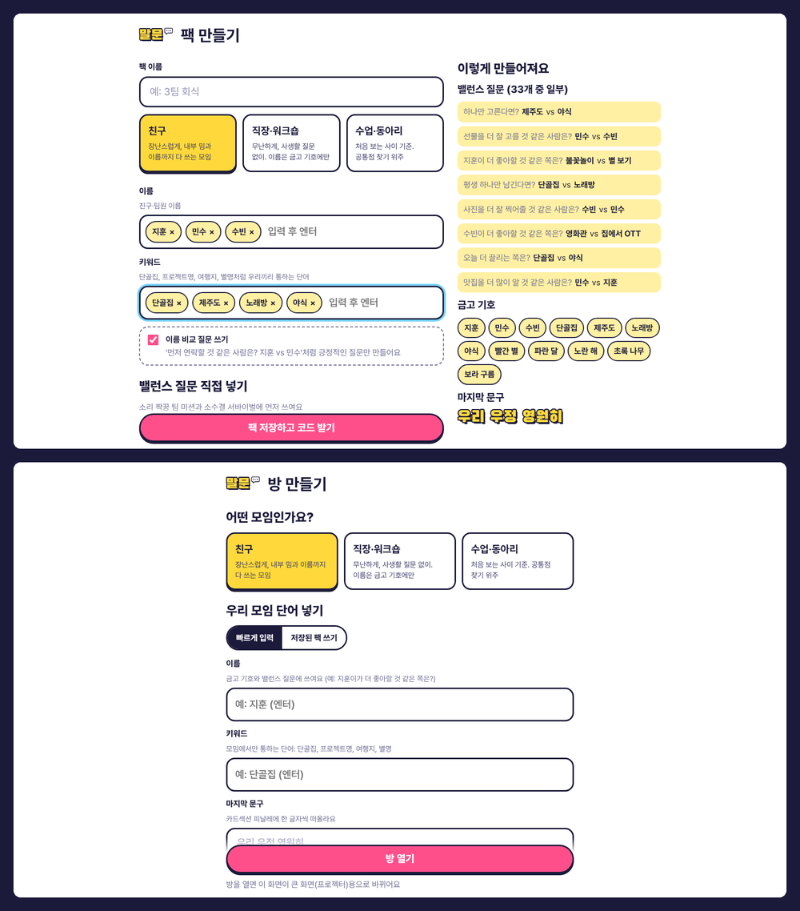
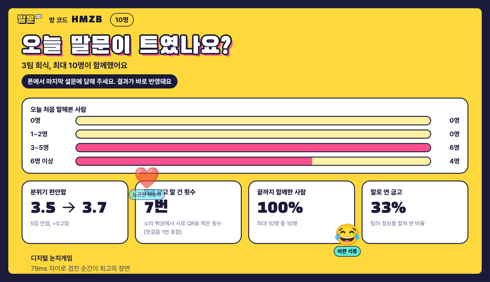
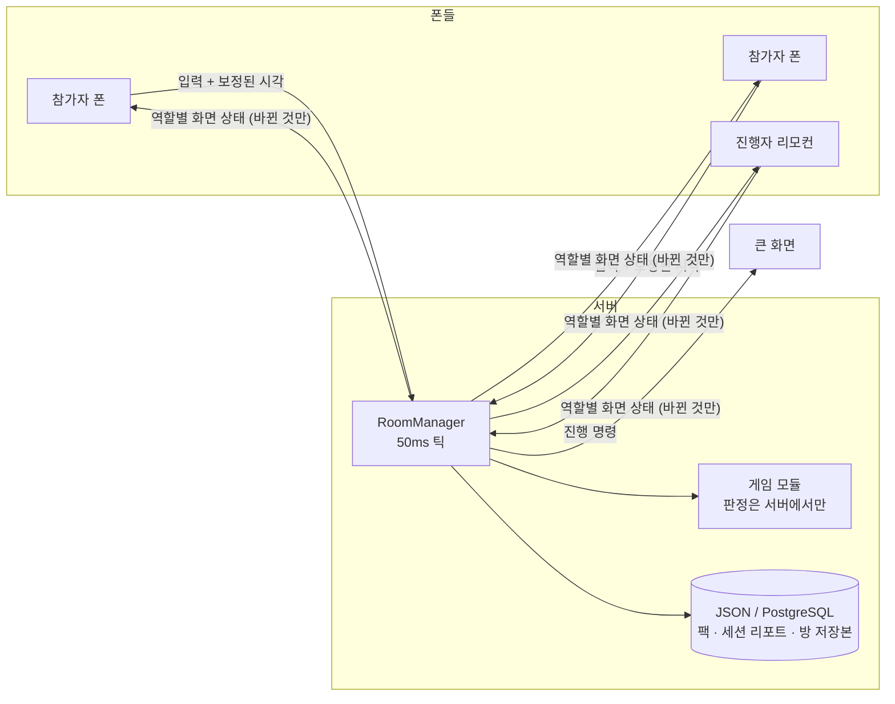

# 말문

**QR 하나로 들어와서, 폰을 들고 같이 노는 20분.**
처음 모인 사람들 사이의 말문을 트기 위한 청중 참여형 실시간 아이스브레이킹 플랫폼입니다. 앱 설치도, 가입도 없습니다.

큰 화면(프로젝터) 하나와 각자의 폰만 있으면 됩니다. 게임 규칙이 사람들을 **화면이 아니라 서로를 보게** 만들도록 설계했습니다. 같은 소리를 내는 사람을 귀로 찾아가고, 각자 조각만 가진 정보를 말로 합쳐 금고를 열고, 마지막에는 모두의 폰이 모여 하나의 전광판이 됩니다.



## 왜 만들었나

| 기존 방식           | 문제                           | 말문의 접근                                         |
| ------------------- | ------------------------------ | --------------------------------------------------- |
| 돌아가며 자기소개   | 주목받는 부담, 쪽팔림          | 혼자 튀는 순간 없이 **다 같이 동시에** 움직인다     |
| 퀴즈 앱 (카훗 등)   | 각자 화면만 본다               | 정답이 화면이 아니라 **옆 사람 입**에 있게 만든다   |
| 레크리에이션 진행자 | 준비가 많이 들고 모임마다 같다 | 이름·키워드만 넣으면 **우리 모임 전용 게임**이 된다 |

## 게임

설계서의 기본 순서는 **웃음 → 섞임 → 협동 → 일체감**입니다. 진행자가 순서와 게임을 고를 수 있고, ⑤⑥은 구현하면서 추가한 게임입니다.

|     | 게임                 | 이렇게 논다                                                              | 말문이 트이는 장치                    | 기술 포인트                                                              |
| --- | -------------------- | ------------------------------------------------------------------------ | ------------------------------------- | ------------------------------------------------------------------------ |
| ①   | **디지털 눈치게임**  | 화면 전체가 버튼. 같은 숫자를 0.3초 안에 겹쳐 누르면 벌칙                | 설명 없이 바로 웃음                   | NTP식 시계 동기화로 **도착 순서가 아닌 누른 순간**을 판정                |
| ②   | **소리 짝꿍**        | 내 폰에서 동물 소리가 난다. 같은 소리를 내는 사람을 찾아 QR을 찍는다     | 처음 보는 사람에게 다가가 말 걸기     | Web Audio로 소리를 직접 합성, 카메라 QR 인식, 유니온-파인드 팀 병합      |
| ③   | **비대칭 금고 따기** | 팀원마다 다른 조각(순서·변환표·다이얼)만 보인다. 화면을 보여주면 안 된다 | 정보가 쪼개져 있어서 말할 수밖에 없다 | 시드 기반 퍼즐 생성, 금고마다 역할 회전                                  |
| ④   | **인간 카드섹션**    | 앉은 자리를 고르고 폰을 머리 위로. 방 전체가 한 화면이 된다              | 마지막의 일체감                       | 프레임을 보내지 않고 **모든 폰이 같은 프레임 함수를 서버 시각으로 계산** |
| ⑤   | **소수결 서바이벌**  | 더 많이 고른 쪽이 탈락. 투표 전에 작전 타임                              | 설득·동맹·배신                        | 탈락자는 예언자가 되어 계속 참여                                         |
| ⑥   | **군중 조종 레이스** | 팀원 전원의 폰 기울기 평균으로 배 한 척을 조종                           | 소리쳐서 방향을 맞춰야 한다           | 모션 센서, 서버 물리 시뮬레이션                                          |





게임별 규칙과 판정 방식은 [docs/games.md](docs/games.md)에 있습니다.

## 우리 모임 전용으로 바꾸기

방을 만들 때 친구 이름, 모임 키워드, 벌칙, 마지막 문구를 넣으면 게임 속 단어와 질문이 바뀝니다. 게임 규칙은 그대로 두고 **단어만 갈아 끼우는** 방식이라 무엇을 넣어도 게임이 깨지지 않습니다.

- **템플릿과 조사 자동 처리**: `{name:이/가} 더 좋아할 것 같은 쪽은?` → "지훈이 더 좋아할…", "수빈이 더 좋아할…" (받침에 맞춰 이/가, 을/를, 으로/로)
- **모임 성격별 프리셋**: 친구(이름으로 놀리기까지), 직장·워크숍(사생활 질문 없음, 이름은 금고 기호에만), 수업·동아리(처음 보는 사이 기준)
- **팩 공유**: 한 번 만든 팩은 6자리 코드로 다시 쓰고, 편집 키가 있는 사람만 고칠 수 있습니다
- **금칙어 필터**: 띄어쓰기·기호로 우회해도 걸러냅니다



## 효과를 숫자로

세션이 끝나면 리포트가 남습니다. 발표 자료의 근거가 되는 지표입니다.

- 시작할 때와 끝날 때의 **분위기 점수** (5점 척도)
- **오늘 처음 말해본 사람 수** (종료 설문)
- **얼굴 보고 말 건 횟수** (소리 짝꿍에서 서로 QR을 찍은 횟수)
- 끝까지 함께한 비율, 말로 연 금고 비율
- 리허설용 봇은 지표에서 빠집니다 (사람만 셉니다)

설문에 답한 참가자 폰에는 **오늘 같은 팀이었던 사람**의 이름이 남습니다. 아이스브레이킹이 끝나면 이름부터 잊기 쉬워서, 나가면서 한마디 더 걸 수 있게 합니다.

종료 설문에는 선택으로 **한 줄 소감**을 남길 수 있고, 이름 없이 섞여서 큰 화면과 리포트에 뜹니다. 리포트 페이지에서는 **공유 이미지**(1080×1350, 폰에서는 카카오톡 등 공유 시트로), **PDF**(인쇄), **원본 데이터(JSON)** 로 가져갈 수 있습니다. 리포트는 마지막으로 바뀐 날부터 30일 뒤 자동으로 지워집니다 (`SESSION_RETENTION_DAYS`).



## 화면 구성

| 주소                       | 누가      | 하는 일                                                                                      |
| -------------------------- | --------- | -------------------------------------------------------------------------------------------- |
| `/`                        | 모두      | 방 코드로 입장, 방 만들기                                                                    |
| `/host/new`                | 진행자    | 모임 성격·단어·게임 순서 정하고 방 열기                                                      |
| `/host/:code`              | 큰 화면   | 대기실 QR, 게임 진행 화면. `Space`·`Enter`·`→` 다음, `P` 일시정지, `F` 전체 화면, `M` 효과음 |
| `/play/:code`              | 참가자 폰 | 입장(닉네임 자동 생성), 게임 조작, 리액션, 설문                                              |
| `/remote/:code`            | 진행자 폰 | PIN으로 붙는 리모컨. 큰 화면 앞에 서 있지 않아도 진행                                        |
| `/pack/new`, `/pack/:code` | 진행자    | 커스텀 팩 만들기·고치기, 미리보기                                                            |
| `/sync`                    | 시연      | 폰 여러 대를 나란히 두고 같은 순간에 깜빡이는지 확인하는 동기화 테스트                       |
| `/report/:id`              | 진행자    | 세션 리포트                                                                                  |

## 시작하기

필요한 것: Node.js 20 이상, pnpm 10 (`corepack enable`이면 자동)

```bash
pnpm install
pnpm dev          # 서버 :3001 + 웹 :5173 (변경 즉시 반영)
```

1. 컴퓨터 브라우저에서 `http://localhost:5173` → **방 만들기**
2. 폰은 같은 와이파이에서 `http://<컴퓨터 IP>:5173` 으로 들어옵니다. 큰 화면도 IP 주소로 열어야 QR이 폰에서 열리는 주소를 가리킵니다.
3. 모션 센서(레이스)와 카메라(QR 스캔)는 **HTTPS에서만** 열립니다. `pnpm dev:https`로 자체 서명 인증서를 쓰고, 폰에서 경고가 뜨면 계속 진행하세요. 센서가 안 되는 폰은 화면 버튼과 숫자 코드 입력으로 똑같이 참여할 수 있습니다.

### 혼자서 테스트하기

가장 간단한 방법은 대기실의 **봇 5명 넣기** 버튼입니다. 서버 안의 가상 참가자가 들어와 게임 6종을 함께 하므로, 혼자서도 내 폰 하나로 리허설할 수 있습니다. 팀을 나눌 때 사람과 봇은 섞지 않고, 리포트에는 사람만 셉니다.

터미널에서는 진짜 소켓으로 들어오는 봇을 띄울 수 있습니다 (부하 테스트에도 씁니다).

```bash
# 방을 만들고 봇 12명이 끝까지 플레이. 출력되는 큰 화면 주소를 브라우저로 열면 구경할 수 있다
pnpm bots --count 12 --web http://localhost:5173
pnpm bots --count 8 --room ABCD      # 내가 연 방에 봇만 넣기 (진행은 내가, 내 폰도 함께 참여)
pnpm bots --count 30 --fast          # 짧은 설정으로 빠르게 한 바퀴
```

### 배포용 실행

```bash
pnpm build        # 웹 정적 파일 + 서버 번들
pnpm start        # 서버가 웹 앱까지 함께 제공 (:3001)
```

## 스크립트

| 명령                                       | 하는 일                                                                                                                                              |
| ------------------------------------------ | ---------------------------------------------------------------------------------------------------------------------------------------------------- |
| `pnpm dev` / `pnpm dev:https`              | 개발 서버 (HTTPS는 폰 센서·카메라 테스트용)                                                                                                          |
| `pnpm build` / `pnpm start`                | 빌드 / 운영 실행                                                                                                                                     |
| `pnpm test`                                | 단위 + 통합 테스트 전체 (112개)                                                                                                                      |
| `pnpm typecheck`                           | 모든 패키지 타입 검사                                                                                                                                |
| `pnpm bots`                                | 가짜 참가자 봇                                                                                                                                       |
| `pnpm load --count 150`                    | 동시 접속 부하 테스트                                                                                                                                |
| `pnpm clock-sim`                           | 시계 동기화 정확도 시뮬레이션                                                                                                                        |
| `pnpm screens --url http://localhost:3001` | 봇이 노는 동안 큰 화면·폰 화면을 단계별로 캡처 (43장). `--phone 844x390`(가로), `344x882`(폴드 겉화면), `690x830`(펼친 폴드)로 폰 크기를 바꿔 찍는다 |

## 구조

```
caps/
├─ packages/shared   프로토콜 타입, 시계 동기화 수학, 팩 엔진, 게임 6종의 규칙 (순수 함수, 서버·웹·봇이 함께 씀)
├─ apps/server       Node.js + Socket.IO 실시간 서버, 팩·리포트 API, 저장소 (JSON 파일 / PostgreSQL)
├─ apps/web          React 앱: 큰 화면, 참가자 폰, 리모컨, 팩 편집기, 동기화 테스트, 리포트
├─ tools             봇, 부하 테스트, 화면 캡처, 시계 시뮬레이션
└─ docs              아키텍처, 게임 규칙, 시연 가이드
```



핵심 설계는 세 가지입니다.

1. **서버가 유일한 심판**: 폰은 입력만 보내고, 판정은 서버의 게임 모듈이 합니다. 폰마다 보이는 정보가 다른 게임(금고)도 서버가 역할별 화면을 따로 만들어 보내므로 다른 사람의 조각을 엿볼 수 없습니다.
2. **시계 동기화**: 폰마다 서버 시계와의 차이를 NTP 방식으로 추정합니다. 눈치게임은 이 값으로 보정한 "누른 순간"으로 판정하고, 카드섹션은 모든 폰이 같은 서버 시각에 같은 프레임을 계산합니다.
3. **게임은 순수 모듈**: 게임 하나는 `init / input / tick / hostView / playerView / summary`를 가진 순수 로직입니다. 시드 난수를 쓰므로 같은 입력이면 같은 결과가 나와서 테스트하기 쉽고, 새 게임을 추가할 때 서버를 건드리지 않습니다.

자세한 내용은 [docs/architecture.md](docs/architecture.md)에 있습니다.

## 검증

| 항목                      | 결과                                                                                                                                                                                                  |
| ------------------------- | ----------------------------------------------------------------------------------------------------------------------------------------------------------------------------------------------------- |
| 단위 테스트 (shared)      | 79개: 시계 추정, 조사 처리, 팩 엔진, 금칙어, 게임 6종 규칙, 봇의 판단, 팩 템플릿·진행 멘트·리포트 요약, **게임 6종을 매 순간 저장·복구해도 결과가 같음**                                              |
| 통합 테스트 (server)      | 30개: 실제 소켓으로 API·방 수명주기·재접속·강퇴, **봇이 게임 6종을 처음부터 끝까지 플레이**, 사람 1명 + 가상 참가자 8명, **게임 도중 서버를 껐다 켜도 이어서 진행**, PIN 잠금·정원, PostgreSQL 저장소 |
| 시계 동기화 시뮬레이션    | 지터·지연 폭증이 있는 망 2000회: 오차 p95 **6.1ms** (핑 한 번이면 60.3ms)                                                                                                                             |
| 부하 테스트 (한 방 150명) | 핑 왕복 p95 10.5ms, 서버 틱 처리 평균 4.3ms / 최대 8.1ms (틱 간격 50ms), 초당 1,400여 개 메시지                                                                                                       |
| 참가자 폰 첫 로딩         | JS 약 130KB + CSS 약 40KB (gzip, 최적화 전 391KB). QR 인식 라이브러리와 진행자 화면은 필요할 때만 내려받음                                                                                            |

부하 테스트와 시뮬레이션은 같은 컴퓨터에서 잰 값입니다. 실제 와이파이에서는 왕복 시간이 늘어나지만 판정은 보정된 시각으로 하므로 결과에 영향이 작습니다.

## 배포

한 컨테이너에서 서버와 웹 앱을 함께 제공합니다. 지금은 **Render 무료 플랜**(싱가포르)에 올라가 있고 `main`에 푸시하면 저절로 다시 배포됩니다: https://malmun-pbrw.onrender.com

- 무료 플랜은 15분 동안 접속이 없으면 잠들어서 첫 접속이 30초쯤 걸립니다. **발표 10분 전에 한 번 열어** 깨워 두세요.
- 무료 플랜에는 디스크가 없으므로 `DATABASE_URL`에 Render PostgreSQL의 **내부 주소(Internal Database URL)** 를 넣어 팩·리포트·방 저장본을 보관합니다. 외부 주소(`*.render.com`)를 넣으면 TLS를 저절로 켭니다 (`PGSSL`로 직접 정할 수도 있음). 무료 PostgreSQL은 만든 지 30일 뒤 만료됩니다.
- Railway용 설정(`railway.json`)도 들어 있습니다.

```bash
docker build -t malmun .
docker run -p 3001:3001 -v malmun-data:/data malmun
```

- 폰 센서·카메라 때문에 **HTTPS가 필요**합니다. HTTPS를 붙여 주는 호스팅(Render, Fly.io, Railway 등)이나 리버스 프록시 뒤에 두세요.
- `DATABASE_URL`을 주면 JSON 파일 대신 PostgreSQL에 저장합니다 (테이블 자동 생성). 환경 변수 목록은 [.env.example](.env.example)에 있습니다.
- 방은 메모리에서 돌고 **3초마다 저장본**을 남깁니다. 서버가 재배포·재시작돼도 진행 중인 방이 멈춘 자리에서 일시정지 상태로 돌아오고, 폰들은 저절로 다시 붙습니다. 진행자가 **다시 진행**을 누르면 이어서 합니다.
- 방 상태를 한곳에 두므로 **서버 한 대**로 운영합니다. 한 방 150명 기준으로 여유가 충분하고, 서버 전체 방 수는 `MAX_ROOMS`(기본 500)로 제한합니다.

## 설계서와 달라진 점

- **추가한 것**: 게임 2종(소수결 서바이벌, 군중 조종 레이스), 진행자 리모컨, 실시간 리액션, 동기화 테스트 페이지, 세션 리포트 페이지, 봇·부하 테스트·화면 캡처·시계 시뮬레이션 도구
- **운영하며 더한 것**: 대기실에서 바로 넣는 가상 참가자(리허설), 서버 재시작 복구, 큰 화면 효과음(파일 없이 합성, `M`으로 끄기), 전체 화면을 풀지 않는 확인 창, 끝난 뒤 "오늘 같은 팀이었던 사람"
- **ORM 대신 `pg` 직접 사용**: 테이블이 세 개(팩, 세션, 방 저장본)뿐이라 ORM보다 SQL 몇 줄이 단순합니다. 테스트는 메모리 PostgreSQL(pg-mem)로 합니다.
- **부하 테스트는 봇으로**: 별도 부하 도구 대신 실제 게임을 하는 봇을 띄워, 진짜 프로토콜과 게임 흐름 그대로 잽니다.
- **일정**: 5주 계획을 기반 구현 단계에서 한꺼번에 진행했습니다.

## 시연

발표 시연 순서와 준비물, 문제가 생겼을 때의 대처는 [docs/demo.md](docs/demo.md)에 정리했습니다.
