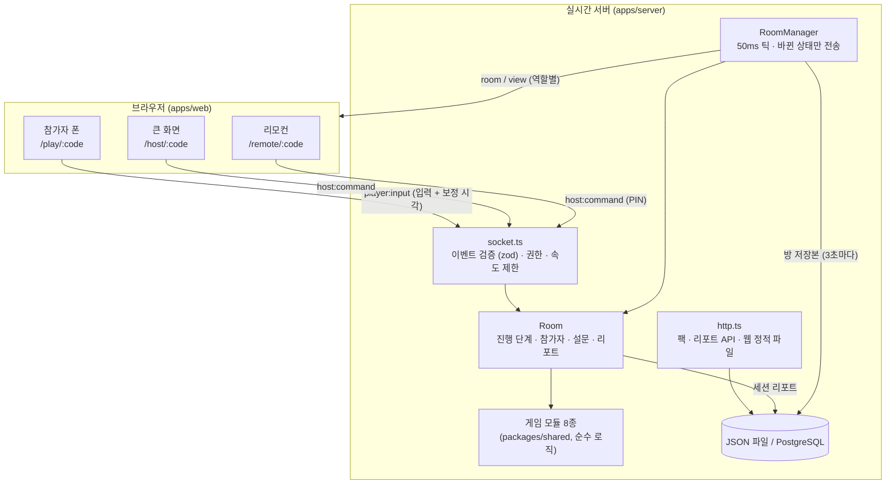
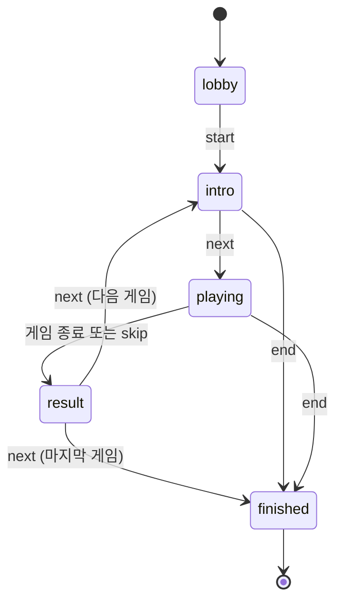

# 아키텍처

말문은 "큰 화면 1대 + 폰 N대"가 한 방에 모여 실시간으로 노는 구조입니다. 이 문서는 그 구조를 떠받치는 결정들과 이유를 정리합니다.

## 1. 전체 그림



패키지는 넷입니다.

| 패키지            | 역할                                                             | 의존                                      |
| ----------------- | ---------------------------------------------------------------- | ----------------------------------------- |
| `packages/shared` | 프로토콜 타입, 시계 동기화 수학, 팩 엔진, 게임 규칙, 입력 스키마 | zod (서버만 사용)                         |
| `apps/server`     | Socket.IO 실시간 서버, HTTP API, 저장소                          | shared, express, socket.io, pg            |
| `apps/web`        | React 클라이언트 (큰 화면, 폰, 리모컨, 편집기)                   | shared, react, socket.io-client           |
| `tools`           | 봇, 부하 테스트, 화면 캡처, 시계 시뮬레이션                      | shared, socket.io-client, playwright-core |

게임 규칙이 `shared`에 있어서 서버(판정), 웹(타입과 연출 함수), 봇(자동 플레이)이 같은 코드를 씁니다.

## 2. 서버가 유일한 심판

폰은 "무엇을 했는지"만 보내고, 결과는 서버가 정합니다.

- **조작 방지**: 폰이 결과를 보내는 구조라면 개발자 도구로 점수를 바꿀 수 있습니다. 판정을 서버에서 하면 폰이 보낼 수 있는 건 입력뿐입니다.
- **정보 비대칭**: 금고 게임은 팀원마다 다른 조각을 봐야 합니다. 서버가 `playerView(state, ctx, playerId)`로 사람마다 화면 상태를 따로 만들어 보내므로, 다른 사람의 조각은 애초에 그 폰에 도착하지 않습니다.
- **역할별 화면**: 큰 화면과 리모컨은 `hostView`, 참가자는 `playerView`를 받습니다. 큰 화면에는 전체 현황과 연출이, 폰에는 내 행동에 필요한 것만 갑니다.

### 진행 단계



진행자는 `start / next / skip / pause / resume / end / kick / setFlow / addBots / clearBots`와 게임별 명령(`game` + action)을 보냅니다. 모든 명령은 서버에서 zod 스키마로 검증하고, 진행자 토큰이나 리모컨 PIN이 없는 소켓의 명령은 거절합니다.

### 일시정지와 게임 시계

게임은 서버 시각이 아니라 **게임 시계**로 움직입니다.

```
게임 시계 = 서버 시각 − timeBase      (timeBase = 지금까지 멈춰 있던 시간의 합)
```

일시정지하면 게임 시계가 멈추고, 다시 시작하면 멈춘 시간만큼 `timeBase`가 늘어납니다. 그래서 금고의 남은 시간, 카드섹션의 연출 시각, 레이스의 물리가 모두 함께 멈췄다가 이어집니다. 게임 모듈은 이 사실을 몰라도 됩니다. 서버 재시작 복구(9절)도 같은 장치를 씁니다: 저장한 순간에 게임 시계를 멈춰 둔 채로 되살리므로, 서버가 꺼져 있던 시간만큼 타이머가 흐르지 않습니다.

## 3. 시계 동기화

눈치게임은 "누가 먼저 눌렀나"를, 카드섹션은 "모든 폰이 같은 순간에 같은 색"을 요구합니다. 폰마다 시계가 다르고 와이파이 지연은 들쭉날쭉하므로, 폰은 서버 시계와의 차이(오프셋)를 추정합니다.

**측정**: 폰이 시각 `t0`에 핑을 보내고, 서버가 받은 시각 `ts`를 돌려주고, 폰이 `t1`에 응답을 받습니다.

```
오프셋 θ = ts − (t0 + t1) / 2        왕복 δ = t1 − t0
```

가는 시간과 오는 시간이 같다고 가정하는 식이라, 경로가 비대칭이면 최대 δ/2만큼 틀립니다. 그래서:

1. 입장 직후 100ms 간격으로 **10번** 재고, 이후 10초마다 3번씩 다시 잽니다. 화면이 다시 보일 때와 재접속 때도 몰아서 잽니다.
2. 왕복 시간이 **가장 짧은 3개**만 고르고(지연이 적은 측정일수록 비대칭 오차도 작다), 그 오프셋의 **중앙값**을 씁니다.
3. 폰 쪽 시각은 `Date.now()`가 아니라 `performance.now()`(단조 시계)로 잽니다. 사용자가 시계를 바꿔도 흔들리지 않습니다.

**검증** (`pnpm clock-sim`, 편도 4~12ms + 지터 평균 15ms + 5% 확률 120ms 폭증, 2000회):

| 추정 방법                         | 오차 p50  | 오차 p95  |
| --------------------------------- | --------- | --------- |
| 핑 한 번                          | 6.6ms     | 60.3ms    |
| 10번 단순 평균                    | 4.4ms     | 14.0ms    |
| **왕복 짧은 3개의 중앙값 (채택)** | **1.8ms** | **6.1ms** |

눈치게임의 충돌 창이 300ms이므로 p95 6ms 오차는 판정에 영향을 주지 않습니다. 이 성질은 단위 테스트로도 고정해 두었습니다 (`packages/shared/test/clock.test.ts`).

**입력 시각 검증**: 폰은 입력과 함께 "서버 기준으로 보정한 누른 시각"을 보냅니다. 서버는 이 값을 무조건 믿지 않고 `sanitizeClientTime`으로 거릅니다. 수신 시각보다 50ms 넘게 미래이거나 1초 넘게 과거면 버리고 수신 시각을 씁니다. 시각을 조작해 이득을 볼 수 있는 폭이 그만큼으로 제한됩니다.

## 4. 판정 예: 눈치게임

```
탭 도착 → 버퍼에 (보정 시각) 저장
매 틱: 버퍼의 첫 탭 시각 + 충돌 창(300ms) + 지연 여유(150ms)가 지났으면
        → 창 안의 탭이 2개 이상: 충돌, 겹친 사람 모두 벌칙
        → 1개: 그 사람이 다음 숫자를 가져감
남은 사람이 1명이면 그 사람이 벌칙, 15초 동안 아무도 안 누르면 남은 사람 모두 벌칙
```

지연 여유 150ms가 핵심입니다. 느린 폰의 탭은 늦게 도착하지만 보정 시각은 이르므로, 조금 기다렸다가 확정해야 도착 순서가 아닌 **누른 순서**로 판정할 수 있습니다. 테스트 `도착 순서가 아니라 보정된 탭 시각으로 판정한다`가 이 동작을 확인합니다.

## 5. 상태 전송

- 서버는 **50ms마다** 모든 방을 진행시키고(`tick`), 상태가 바뀐 방만 내보냅니다.
- 소켓마다 마지막으로 보낸 JSON을 기억해서 **같은 내용은 다시 보내지 않습니다**. 금고처럼 사람마다 화면이 다른 게임도 바뀐 사람에게만 갑니다.
- 메시지는 `room`(진행 단계, 참가자 등 방 정보)과 `view`(지금 게임의 내 화면 상태) 두 종류입니다.
- 클라이언트는 받은 상태를 그대로 그립니다 (`useSyncExternalStore`). 화면이 계산하는 건 남은 시간 같은 시계 기반 값뿐입니다.

리액션(👏😂😮❤️🔥)은 상태가 아니라 이벤트로 큰 화면에만 보내고, 한 사람이 2초에 4번까지만 보낼 수 있습니다.

게임 입력과 리액션은 **volatile**로 보냅니다. Socket.IO는 연결이 끊긴 동안의 emit을 모아 두었다가 다시 붙으면 한꺼번에 보내는데, 그러면 몇 초 전의 탭·투표가 "지금" 일어난 일로 판정됩니다. 끊긴 동안 누른 것은 버리고, 화면은 연결 중이라고 알립니다.

## 6. 게임 모듈

게임 하나는 다음 인터페이스를 구현하는 순수 로직입니다 (`packages/shared/src/games/types.ts`).

```ts
interface GameModule<S, HostView, PlayerView> {
  meta: GameMeta; // 제목, 규칙, 최소 인원, 필요한 권한, 팩에서 쓰는 항목
  init(ctx): S; // 상태 만들기 (JSON으로 직렬화 가능한 순수 데이터)
  start(state, ctx): void; // 소개 → 플레이
  input(state, ctx, playerId, input, at): void; // 참가자 입력 (at = 검증된 게임 시계)
  hostAction?(state, ctx, action, data): void; // 진행자 명령 (예: 검색 끝내기, 연출 시작)
  tick(state, ctx): void; // 50ms마다
  finished(state, ctx): boolean;
  hostView(state, ctx): HostView; // 큰 화면에 보낼 것
  playerView(state, ctx, playerId): PlayerView; // 이 사람에게 보낼 것
  summary(state, ctx): GameSummary; // 결과 화면, 다음 게임에 넘길 팀, 지표
  playerJoined?(state, ctx, playerId): void; // 도중 입장 처리
}
```

- `ctx`에는 게임 시계, 참가자, 팀, 모임 팩, **시드 난수**, 설정, 앞선 게임 기록이 들어 있습니다. 같은 시드와 입력이면 같은 결과가 나오므로 테스트가 결정적입니다.
- 게임끼리 이어지는 정보는 `summary`로만 넘깁니다. 소리 짝꿍이 만든 팀을 금고·카드섹션·레이스가 이어받고, 금고 순위가 카드섹션의 팀 색 물결 순서가 됩니다.
- 새 게임은 모듈 하나와 화면 컴포넌트 둘(큰 화면, 폰)을 만들어 등록하면 됩니다. 서버 코드는 바뀌지 않습니다.

## 7. 카드섹션: 프레임을 보내지 않는 동기 연출

수십 대의 폰이 하나의 전광판처럼 움직이려면 매 프레임 색을 보내야 할 것 같지만, 그러면 초당 수천 개의 메시지가 필요하고 와이파이 지연이 그대로 화면에 드러납니다.

대신 서버는 연출 시작 시각과 파라미터(행·열, 팀 색 순서, 문구, 길이)를 **한 번만** 보냅니다. 각 폰은 매 애니메이션 프레임마다

```ts
showFrame(params, { row, col, teamRank }, 게임시계 − startAt)  →  { 배경색, 글자색, 글자 }
```

를 계산합니다. 같은 함수, 같은 입력, 동기화된 시계이므로 모든 폰이 같은 순간에 같은 프레임을 그립니다. 큰 화면의 격자 미리보기도 같은 함수로 그립니다. 연출은 카운트다운 → 색 파도 → 팀 색 물결(금고 순위순) → 문구(열마다 한 글자, 길면 흘러감) → 금색으로 모였다가 동시에 꺼짐, 40초입니다.

## 8. 팩 엔진

모임 팩은 게임 규칙을 바꾸지 않고 **단어와 질문만** 바꿉니다 (`packages/shared/src/pack`).

- **템플릿**: `{name:이/가}`, `{keyword:을/를}` 자리에 이름과 키워드를 넣고, 받침에 맞춰 조사를 고릅니다. 숫자와 영어는 읽는 소리 기준으로 판단하고(`3팀이`, `Tom이`), 판단할 수 없으면 `이(가)`처럼 병기합니다.
- **프리셋**: 친구 프리셋은 이름으로 비교 질문을 만들고, 직장 프리셋은 이름을 금고 기호에만 쓰며, 수업 프리셋은 이름을 쓰지 않습니다. 모임 성격에 따라 놀림의 수위가 달라야 하기 때문입니다.
- **부족하면 채운다**: 키워드가 모자라면 금고 기호를 기본 기호로 채우고, 질문이 모자라면 프리셋 기본 질문을 씁니다. 무엇을 넣든(혹은 아무것도 안 넣든) 게임이 성립합니다.
- **금칙어 필터**: 공백·기호를 지우고 비교해서 `바 보` 같은 우회도 잡습니다. 팩 저장, 닉네임, 즉석 입력 모두에 적용합니다.

## 9. 저장소와 재시작 복구

저장하는 건 **팩**, **세션 리포트**, **방 저장본** 세 가지입니다. 방은 메모리에서 돌고, 저장본은 서버가 다시 켜질 때만 읽습니다.

- 기본은 `JsonStorage`: 설치 없이 바로 쓰는 파일 저장소. 임시 파일에 쓰고 `rename`해서 쓰다가 꺼져도 파일이 깨지지 않습니다. 쓰기는 한 줄로 세워 순서가 꼬이지 않고, 실패하면 요청한 쪽에 그대로 알리며 메모리의 팩도 되돌립니다.
- `DATABASE_URL`이 있으면 `PgStorage`: 테이블 `packs`, `sessions`, `room_snapshots`를 자동으로 만듭니다(JSONB). 테스트는 pg-mem으로 실제 SQL을 실행합니다.
- 세션 리포트는 게임이 끝날 때마다 2초 디바운스로 저장되고, 방이 정리될 때도 저장됩니다. 아무도 없는 방은 2시간(끝난 방은 30분) 뒤 메모리에서 지웁니다.

### 서버가 꺼졌다 켜지면

발표 도중 서버가 재배포되거나 죽으면 방이 통째로 사라지는 것이 가장 큰 운영 위험이었습니다. 그래서 `RoomManager`가 **3초마다** 모든 방의 저장본(`RoomSnapshot`)을 씁니다.

- **무엇을 담나**: 진행 단계, 참가자(토큰·닉네임·색·설문), 팀, 지난 게임 기록, 지금 게임의 상태, 진행자 토큰과 리모컨 PIN. 게임 상태는 처음부터 "JSON으로 직렬화 가능한 순수 데이터"로 설계했기 때문에 그대로 담깁니다. 소켓, 속도 제한, 봇의 머리처럼 메모리에만 의미가 있는 것은 담지 않고 복구할 때 새로 만듭니다.
- **언제 쓰나**: 게임 시계가 흐르는 방(소개·플레이 중이고 멈추지 않음)이 있으면 매번, 아니면 내용이 바뀌었을 때만 씁니다. 한가한 서버는 디스크를 건드리지 않습니다. 앞선 쓰기가 끝나기 전에는 겹쳐 쓰지 않고, 종료 신호(SIGTERM)를 받으면 마지막으로 한 번 더 씁니다.
- **어떻게 되살리나**: 새 서버가 접속을 받기 전에 저장본을 읽습니다. 게임 중이던 방은 **저장한 순간에서 일시정지**한 채로 돌아옵니다. 사람들은 "잠깐 나간" 상태로 시작하고, 폰의 소켓이 저절로 다시 붙으면서 참가자 토큰으로 같은 사람으로 돌아옵니다. 큰 화면과 리모컨도 진행자 토큰으로 다시 붙습니다. 큰 화면에는 "이어서 할 준비 중"과 돌아온 인원이 보이고, 진행자가 **다시 진행**(멈춘 동안에는 큰 버튼과 `Space`)을 누르면 이어서 합니다. 2시간 넘게 쉬던 방은 버립니다.
- **검증**: 게임 8종을 봇 8명으로 끝까지 돌리면서 매 틱마다 상태를 JSON으로 왕복시켜도, 왕복하지 않은 판과 결과가 같은지 확인합니다(`restart-safety.test.ts`). 통합 테스트는 게임 도중 서버를 실제로 껐다 켜고 같은 토큰으로 같은 사람이 돌아오는지 봅니다(`restore.test.ts`).
- **한계**: 마지막 저장 뒤 3초 안의 입력은 잃을 수 있습니다. 저장본은 서버 한 대를 기준으로 하나를 통째로 덮어씁니다.

## 10. 가상 참가자 (봇)

사람을 모으기 어려운 리허설이나, 인원이 모자란 모임을 위해 진행자가 대기실에서 **봇 5명 넣기**를 누르면 서버 안에 가상 참가자가 생깁니다.

- **같은 머리**: 봇이 무엇을 할지는 `packages/shared/src/bots.ts`의 `BotBrain`이 정합니다. 화면 상태(`playerView`)만 보고 판단하므로 사람과 같은 정보로 놉니다. 터미널의 소켓 봇(`pnpm bots`, 부하 테스트)과 서버 안의 봇이 같은 코드를 씁니다.
- **귀와 눈 대신**: 소리 짝꿍의 "같은 소리 듣기"와 금고의 "말로 조각 합치기"는 봇끼리 `BotHub`라는 공유 메모로 흉내 냅니다.
- **사람과 섞지 않는다**: 팀을 나눌 때 사람끼리, 봇끼리 따로 나눕니다. 사람이 봇을 찾으러 돌아다니거나, 봇과 말로 금고를 열 수는 없기 때문입니다.
- **지표에서 뺀다**: 최고 인원, 끝까지 남은 비율, 설문, "오늘 같은 팀이었던 사람"은 사람만 셉니다. 봇은 설문에 답하지 않고, 리포트에는 봇 수를 따로 적습니다.
- 방 하나에 40명까지, 0.1초마다 생각합니다. 사람이 아무도 없고 봇만 남은 방은 빈 방처럼 정리합니다.

## 11. 보안과 오남용 방지

| 위협                        | 대응                                                                                                                                 |
| --------------------------- | ------------------------------------------------------------------------------------------------------------------------------------ |
| 참가자가 진행자 명령을 보냄 | 방을 만들 때 받은 진행자 토큰(주소 `#t=`로 전달 후 로컬 저장소로 옮김)이나 리모컨 PIN이 있어야 명령 가능. PIN 시도는 연결당 분당 5회 |
| 연결을 바꿔 가며 PIN 찍기   | 방마다 5분에 10번 틀리면 그 방의 리모컨 로그인을 잠시 잠금 (연결과 무관)                                                             |
| 방·참가자 폭증              | 서버 전체 방 수 `MAX_ROOMS`(기본 500), 방 정원은 지금 접속한 사람 기준 + 나간 사람 기록까지 합친 상한                                |
| 브라우저 쪽 공격 면         | `nosniff`, `no-referrer`, 프레임 삽입 금지, 카메라·모션 센서는 같은 출처만 (Permissions-Policy)                                      |
| 이상한 입력·거대한 메시지   | 모든 소켓 이벤트와 API 본문을 zod로 검증, 메시지 크기 64KB 제한                                                                      |
| 입력 폭주                   | 참가자 입력 초당 40회, 리액션 2초 4회, 방 만들기 연결당 분당 5회                                                                     |
| 남의 팩 수정                | 팩마다 편집 키 발급, 서버에는 SHA-256 해시만 저장하고 상수 시간 비교                                                                 |
| 시각 조작                   | 보정 시각을 수신 시각 기준 +50ms / −1초 범위에서만 인정                                                                              |
| 강퇴된 사람 재입장          | 같은 참가자 토큰으로 다시 못 들어옴                                                                                                  |
| 부적절한 닉네임·팩          | 금칙어 필터                                                                                                                          |

## 12. 클라이언트

- **연결**: `RoomClient`가 소켓, 시계 동기화, 방 상태를 들고 React에는 `useSyncExternalStore`로 연결합니다. 끊기면 자동으로 다시 붙고, 참가자 토큰으로 같은 사람으로 복귀합니다.
- **소리**: 동물 소리는 녹음 파일이 아니라 Web Audio 오실레이터로 합성합니다. 파일을 내려받지 않고, 팀이 8개를 넘으면 같은 동물이 두 번 빠르게 우는 변형으로 구분합니다. 소리가 안 나는 폰은 의성어 글자로 대신합니다.
- **QR**: 브라우저 내장 `BarcodeDetector`가 있으면 쓰고, 없으면(iOS 등) jsQR로 직접 디코딩합니다. 카메라를 못 쓰면 4자리 숫자 입력으로 똑같이 연결됩니다.
- **아이폰·갤럭시 호환**: 두 기기에서 다르게 동작하는 부분을 하나씩 막았습니다.
  - 소리: 터치 폰은 손을 뗄 때(`pointerup`·`touchend`·`click`)만 소리를 켤 수 있어서 그때 오디오를 엽니다. 아이폰 무음 스위치는 `navigator.audioSession`(iOS 17+)으로, 그보다 오래된 iOS는 무음 `<audio>` 반복 재생으로 넘깁니다. 전화·앱 전환으로 멈춘 오디오는 다음 탭이나 화면 복귀 때 다시 켭니다.
  - 연결: 아이폰은 잠금·앱 전환 중에 웹소켓을 조용히 끊습니다. 화면이 다시 보이면 2.5초 안에 응답을 확인해 바로 다시 붙고, 뒤로 가기 캐시와 네트워크 전환(와이파이↔LTE)도 같게 처리합니다.
  - 카메라: 뒷카메라가 여럿인 갤럭시가 초광각을 잡지 않도록 해상도를 요청하고, 지원하면 연속 초점을 켭니다. 권한 거부와 카메라 없음을 구분해 안내하고, 내장 인식기가 계속 실패하는 기기는 jsQR로 바꿉니다.
  - 화면 꺼짐 방지: Wake Lock이 없는 곳(오래된 iOS, 안드로이드 앱 안 브라우저)은 보이지 않는 무음 영상(`/awake.mp4`, 2KB)을 반복 재생합니다.
  - 앱 안 브라우저: 카카오톡·인스타그램·네이버 앱 등으로 열리면 기본 브라우저로 여는 버튼을 보여 줍니다 (카카오톡은 `kakaotalk://web/openExternal`, 안드로이드는 `intent://`, 아이폰의 다른 앱은 메뉴 안내).
  - 화면: 삼성 인터넷·크롬의 강제 다크 모드가 색을 뒤집지 않게 `color-scheme: light only`, 아이폰이 방 코드를 전화번호로 바꾸지 않게 `format-detection`, 연타 확대 방지, `dvh`를 모르는 브라우저를 위한 `vh` 대체값, 빌드 문법은 iOS 15·크롬 90까지 낮춥니다.
- **세로·가로·접는 폰**: 참가자 화면은 세로가 기본이지만, 높이가 낮은 가로 화면(560px 이하)에서는 정보는 왼쪽, 누르는 것은 오른쪽으로 나눠 주요 버튼이 화면 밖으로 밀리지 않게 합니다 (`styles/orientation.css`). 레이스는 왼쪽·오른쪽 패드를 화면 양 끝에 두어 두 엄지로 잡습니다. 큰 원형 버튼과 좌석 격자는 폭뿐 아니라 높이로도 크기를 제한하고, 글자 크기는 화면의 짧은 변(vmin) 기준이라 폰을 돌려도 비율이 유지됩니다. 갤럭시 폴드 겉화면(약 344px 폭)과 펼친 화면, 둘 다 눕힌 경우까지 캡처로 확인했습니다. 기울기 센서 값은 폰 몸체 기준이므로 화면 방향(0·90·180·270도)에 맞춰 좌우를 다시 계산하고, 게임 도중 폰을 돌려도 이벤트마다 방향을 다시 읽습니다.
- **센서와 화면**: 레이스는 `DeviceOrientation`(iOS는 버튼을 눌러 권한 요청), 카드섹션은 Wake Lock으로 화면 꺼짐을 막습니다. 센서가 없으면 화면 버튼으로 조종합니다.
- **큰 화면 효과음**: 시작 카운트다운, 눈치게임의 충돌, 금고 해제, 소수결 공개 같은 순간에 짧은 효과음을 냅니다. 이것도 파일 없이 합성하고, `M`이나 독의 버튼으로 끕니다(브라우저에 기억). iOS에서는 무음 스위치에 막히지 않도록 오디오 세션을 재생용으로 둡니다.
- **확인 창**: 큰 화면에서 "이 게임 끝내기" 같은 되돌릴 수 없는 동작은 화면 안의 확인 창으로 묻습니다. 브라우저 기본 확인 창은 전체 화면을 풀어 버리기 때문입니다(`Enter` 예, `Esc` 아니요).
- **한글 입력**: 키워드 입력칸은 한글 조합 중의 `Enter`를 무시해서 마지막 글자가 두 번 들어가지 않게 합니다.
- **번들**: 참가자 폰이 처음 받는 양을 줄였습니다. 진행자 화면들은 필요할 때 내려받고(코드 분할), jsQR은 스캐너를 처음 열 때만 받으며, 서버 전용인 zod 스키마는 별도 모듈로 분리해 웹 번들에서 빠집니다. 한글 폰트는 쓰는 글자 조각만 받습니다.

| 내려받는 양 (gzip)                         | 최적화 전      | 지금     |
| ------------------------------------------ | -------------- | -------- |
| 첫 로딩 JS (React, Socket.IO, 게임 화면)   | 206KB          | 약 130KB |
| 첫 로딩 CSS (폰트 조각을 base64로 넣던 것) | 185KB          | 약 40KB  |
| jsQR (스캐너를 처음 열 때만)               | 첫 로딩에 포함 | 약 48KB  |

## 13. 성능

`pnpm load --count 150 --flow tiltrace,minority` (한 방 150명, 레이스 중 초당 8회 기울기 입력, 같은 컴퓨터에서 측정):

| 지표                     | 값                           |
| ------------------------ | ---------------------------- |
| 입장 p95                 | 193ms (20명씩 동시 입장)     |
| 핑 왕복 p50 / p95 / 최대 | 3.2ms / 10.5ms / 13.3ms      |
| 서버 틱 처리 평균 / 최대 | 4.3ms / 8.1ms (틱 간격 50ms) |
| 전송 메시지              | 초당 약 1,400개 (봇당 9.4개) |

틱 하나를 처리하는 데 간격의 1/6 정도만 쓰므로 한 방 150명에서 여유가 있습니다. 방 상태가 메모리에 있어 서버는 한 대로 운영하며, 여러 대로 늘리려면 방 단위 sticky 라우팅과 Socket.IO 어댑터, 그리고 서버마다 따로 쓰는 방 저장본이 필요합니다.
